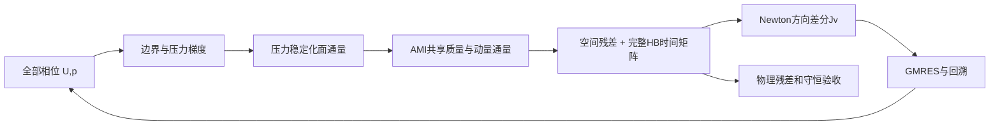

# fullyImplicitHBFoam

独立构造的 OpenFOAM v2112 不可压缩谐波平衡研究求解器。所有相位 U、p 同时进入 Newton–Krylov；压力稳定化面通量随每次残差/Jv 重算；AMI 共享质量和总动量积分通量。

- [数学方法、论文引用及扩展设计](docs/方法推导.md)
- [实际验证结果](docs/验证记录.md)
- [OpenFOAM 主程序](solver/fullyImplicitHBFoam.C)
- [独立 HB / Newton / GMRES 内核](solver/HBAlgebra.H)

## 当前实现范围

常黏度、层流、固定网格、单个连通流体域、单一基频、串行。H=0..64，N=2H+1。支持通过覆盖率、标量面积、矢量面积检查的全覆盖 `cyclicAMI`；普通 `cyclic` 可用于周期边界。每相位单独提供 U、p、可选 bodyForce。

仅接受 `fixedValue`、`zeroGradient`、`empty`、`cyclic`、`cyclicAMI`、`symmetryPlane`、`symmetry` 场边界。闭合压力域逐相位设压力基准；开放零梯度速度出口需固定压力。已测试的场边界为固定值、零梯度、empty、cyclic、cyclicAMI；其余允许项尚未单独验证。

旋转滑移、phase-lag、可变拓扑、部分覆盖 ACMI、湍流、MPI、PIMPLE/Schur 物理预条件尚未实现。数学扩展在方法文档第6–7节。程序主动拒绝不同相位点位和非零 meshPhi；不能把转子快照直接输入本版。

当前 AMI 算法是主侧整面通量的保守转置散射，精度可能依赖主从选择；一般曲面接口可能被矢量面积检查拒绝。需公共交叠子面通量才能进一步扩大适用范围。

## 编译及复现

本机安装 OpenCFD OpenFOAM v2112 且已 source 其环境时：

```bash
./Allwmake
# 如需重建并运行内置测试，还需 Python 3 和 g++：
./Alltest
```

本次实际验证使用官方 `opencfd/openfoam-default:2112` Linux amd64 镜像。macOS 主机运行以下脚本即可复现（需 Docker Desktop、主机 Python 3；镜像内不要求 Python）：

```bash
./tests/run_docker.sh
```

脚本只挂载本工程目录；输出二进制 `bin/fullyImplicitHBFoam` 是 Linux 版本，不能在 macOS 直接运行。`Alltest` 和 Docker 测试脚本会重建本工程的示例输入，并重置带生成标记的回归算例；自定义算例请放在其他目录。

## 算例结构

```text
constant/HBProperties
constant/phase0/polyMesh/ ... constant/phaseNminus1/polyMesh/
0/phase0/U, p, bodyForce ...
system/controlDict
system/phase0/fvSchemes, fvSolution ...
```

每个 phase 的网格点、面、单元标签及边界分区必须一致。物理相位是 `theta_i=2*pi*i/N`，不是 OpenFOAM 的时间目录。输出 `1/phasei/U,p,phi` 表示同一个周期解的全部相位；目录1不代表求解了1秒。

`p` 使用运动学压力单位 m²/s²，`bodyForce` 是 m/s² 加速度，`phi` 是绝对体积通量 m³/s。`HBProperties` 的数值按 SI 单位给出：

```foam
harmonics       1;
omega           1;       // rad/s
nu              0.1;     // m2/s
velocityScale   1;       // m/s
lengthScale     1;       // m
rcTime          0.05;    // s，空间压力稳定化参数，影响离散方程
pRefCell        0;
pRefValue       0;
absoluteTolerance 1e-10;
relativeTolerance 1e-9;
physicalTolerance 1e-7;
maxNewton       30;
gmresRestart    300;
gmresMaxIterations 1200;
linearRelativeTolerance 0.0001;
jacobianStep    1e-6;
```

RMS 收敛后还核验最大动量残差、全部原始连续性残差、AMI 质量和动量通量平衡。迭代未收敛退出2、不写新解；OpenFOAM 输入检查错误通常退出1。重用算例时请检查退出码和本次日志，不要把历史输出误认为本次成功。

## 执行链路



本工程采用 GPL-3.0-or-later。没有读取或复用用户已有不可压缩求解器；参考来源、实现与尚未实现的设计均在方法文档中区分。
